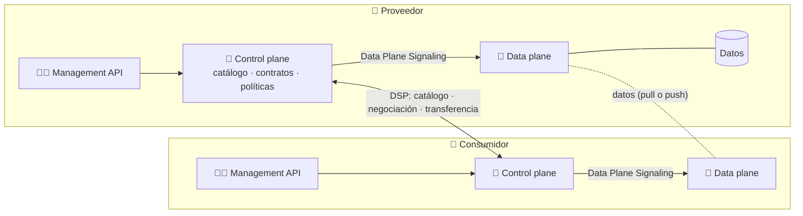
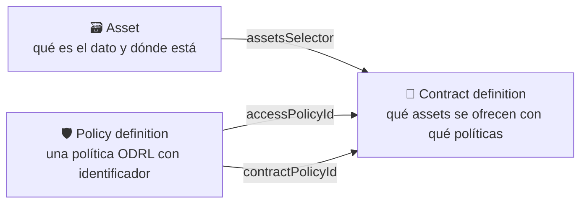
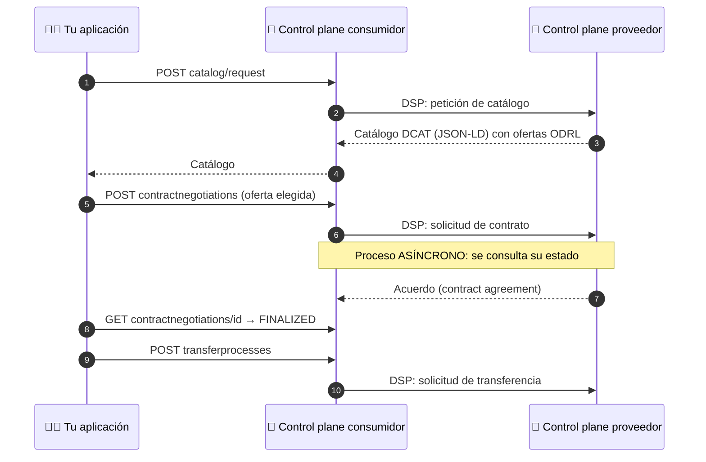
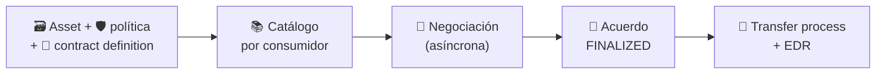

# 🔌 11 · Eclipse EDC — El conector de espacios de datos

**La pieza que convierte todo lo anterior en un sistema real: un conector que publica ofertas, negocia contratos, verifica identidades y mueve datos entre organizaciones.**


> *Learning by building: en `10` simulaste un espacio de datos con scripts. Aquí ves qué hace cada pieza en el conector real, y con qué comandos y JSON se maneja.*

---

## 📑 Índice

1. [🧭 Cómo usar esta guía](#-cómo-usar-esta-guía)
2. [📖 ¿Qué es EDC?](#-qué-es-edc)
3. [🏷️ Versiones y estado](#️-versiones-y-estado)
4. [🏗️ Arquitectura: control plane y data plane](#️-arquitectura-control-plane-y-data-plane)
5. [🔁 De la simulación de `10` al conector real](#-de-la-simulación-de-10-al-conector-real)
6. [🧩 Los tres objetos que publican una oferta](#-los-tres-objetos-que-publican-una-oferta)
7. [🔄 El ciclo con la Management API](#-el-ciclo-con-la-management-api)
8. [🚚 Transferencia y data plane](#-transferencia-y-data-plane)
9. [🔐 Identidad y confianza: DCP, Identity Hub y MVD](#-identidad-y-confianza-dcp-identity-hub-y-mvd)
10. [🛡️ Políticas propias: el motor de políticas](#️-políticas-propias-el-motor-de-políticas)
11. [☁️ EDC-V: conector como servicio](#️-edc-v-conector-como-servicio)
12. [🚀 Cómo empezar](#-cómo-empezar)
13. [🗂️ Estructura de la carpeta](#️-estructura-de-la-carpeta)
14. [⚠️ Errores frecuentes](#️-errores-frecuentes)
15. [🧰 Casos de uso](#-casos-de-uso)
16. [🧠 Chuleta de repaso](#-chuleta-de-repaso)
17. [🏋️ Ejercicios](#️-ejercicios)
18. [📚 Recursos](#-recursos)
19. [➡️ Siguiente paso](#️-siguiente-paso)

---

## 🧭 Cómo usar esta guía

| Si eres… | Ruta recomendada |
| --- | --- |
| 🆕 **Nuevo en EDC** | Lee 2 → 8 en orden y ejecuta el primer sample de [Cómo empezar](#-cómo-empezar). |
| 🔁 **Vienes a repasar** | Ve a la [🧠 Chuleta](#-chuleta-de-repaso), a la tabla de [la simulación al conector real](#-de-la-simulación-de-10-al-conector-real) y al [ciclo con la Management API](#-el-ciclo-con-la-management-api). |
| 🔐 **Te interesa la confianza** | Salta a [Identidad y confianza](#-identidad-y-confianza-dcp-identity-hub-y-mvd). |

> 💡 **Requisitos previos:** `06-ODRL` (políticas), `07-DCAT` (catálogos) y sobre todo `10-Data-Spaces`: aquí se vuelve a recorrer **el mismo ciclo** (identidad → catálogo → negociación → acuerdo → transferencia), pero con el software real.

> ⚠️ **EDC cambia rápido.** Rutas de la API, formatos, módulos y versiones del protocolo varían entre versiones. Los JSON y comandos de este README son **orientativos**, tomados de los *samples* oficiales: **antes de usarlos, contrasta con la documentación y los samples de la versión que uses.** Los estados que se citan son los de **octubre de 2026**.

---

## 📖 ¿Qué es EDC?

**Eclipse Dataspace Components (EDC)** es un proyecto de código abierto de la Eclipse Foundation (Java, licencia Apache-2.0) que ofrece un **marco modular** para construir **conectores** de espacios de datos: el software que cada participante despliega para ofrecer y consumir datos con soberanía.

| EDC… | …y por qué importa |
| --- | --- |
| Es un **marco de extensiones** | Compones el conector que necesitas: persistencia, identidad, políticas y tipos de transferencia son módulos |
| Habla el **Dataspace Protocol (DSP)** con otros conectores | Catálogo, negociación y transferencia, como viste en `10` |
| Usa **ODRL** para las políticas y **DCAT** para el catálogo | Es exactamente lo que has estudiado en `06` y `07` |
| **No es un producto cerrado** | La documentación advierte, por ejemplo, que EDC no trae un data plane listo para usar, sino un marco para construirlo |

> 🧠 **Matiz de nombre:** el proyecto se conoció antes como *Eclipse Dataspace Connector*; hoy se llama *Components*, porque ya no es solo el conector (incluye también Identity Hub, Issuer Service, Federated Catalog…).

---

## 🏷️ Versiones y estado

Según la página de *releases* del repositorio del conector a fecha de octubre de 2026:

| Versión | Estado | Notas |
| --- | --- | --- |
| **v0.18.1** | Marcada como *Latest* (estable) | Hizo del *data plane signaling* el valor por defecto en la 0.18.0 |
| **v1.0.0-RC4** (29 sep) | *Pre-release* | Candidata a 1.0. La página de releases **no muestra el año** de la fecha |

Entre los **cambios incompatibles** que lista la RC4 (hay que migrar con cuidado):

- Se **retiró la Management API v3** (los *samples* actuales todavía usan `/management/v3`).
- Los módulos SPI y las librerías se **consolidaron**; se eliminaron módulos del data plane (incluido el de Kafka).
- Cambios de nombres y modelos (por ejemplo, `Operator.IN` pasa a `IS_PART_OF`).
- Se añaden mejoras de **DCP**: almacén de ámbitos (*scopes*), servicio de tokens de seguridad (STS) y gestión de perfiles de dataspace.

> ⚠️ **Consecuencia práctica:** una guía escrita para la 0.x puede **no funcionar** con la 1.0. Fija la versión y usa los *samples* de **esa misma versión** (etiqueta/tag del repositorio), no solo `main`. No uses una *release candidate* en producción.

---

## 🏗️ Arquitectura: control plane y data plane



| Pieza | Qué hace |
| --- | --- |
| 🧠 **Control plane** | Gestiona **catálogos, contratos, control de acceso y la transferencia**; **no mueve los datos**. Habla DSP con el del otro participante |
| 🚚 **Data plane** | Mueve los datos cuando el control plane se lo ordena. Se registra en el control plane al arrancar y suele desplegarse **por separado** |
| 🧑‍💻 **Management API** | Interfaz REST con la que **tu** aplicación maneja el conector. No debe exponerse a redes no confiables (se autentica con clave o con un proveedor OAuth2) |
| 🪪 **Identity Hub** | Aloja las identidades (DID) y credenciales de un participante y atiende el protocolo de credenciales (DCP) |
| 🏷️ **Issuer Service** | Emite credenciales (por ejemplo, de pertenencia al espacio) |
| 📚 **Federated Catalog** | Rastrea los catálogos de otros participantes para que se puedan consultar en conjunto |

> 🧠 **La separación importante:** *control plane = decidir y acordar*, *data plane = mover*. Es la misma separación que viste en `10` entre «negociar» y «transferir».

---

## 🔁 De la simulación de `10` al conector real

En `10` tu `mini_espacio.py` hacía todo esto en un único script. En EDC cada responsabilidad tiene un nombre propio:

| En `10` (simulación) | En EDC (real) |
| --- | --- |
| Catálogo DCAT con `odrl:Offer` (`catalogo_rdf`) | **Asset + policy definition + contract definition**; el catálogo se **genera por consumidor** al recibir la petición |
| `odrl:Offer` | Política de contrato que ve el consumidor en el catálogo |
| `odrl:Agreement` | **Contract agreement** que nace al finalizar la negociación |
| Credencial de adhesión Ed25519 | **Credenciales verificables** alojadas en un Identity Hub y verificadas con **DCP** |
| Rulebook y `evaluar_participante` | Políticas de acceso y de contrato + credenciales que exigen quién puede ver o negociar qué |
| `ContractRequestMessage`, etc. | Mensajes **DSP** reales entre los control planes |
| Transferencia con datos sintéticos | **Transfer process** con el data plane (pull o push) |
| Registro de usos (`inform`) | Hay que **implementarlo**: ODRL lo describe, pero el conector decide cómo comprobarlo |
| Calidad DQV en la distribución | Propiedades del *asset* (EDC es flexible: tú decides qué metadatos publicas) |

---

## 🧩 Los tres objetos que publican una oferta

Para ofrecer un dato en EDC se crean **tres objetos** en el proveedor (con la Management API):



| Objeto | Qué es |
| --- | --- |
| 🗃️ **Asset** | Un **descriptor** del dato (no el dato): un conjunto de ficheros, una API, un flujo… Su `dataAddress` dice **dónde** está. Las `properties` son **visibles** para los consumidores; las `privateProperties` son internas |
| 🛡️ **Policy definition** | Envuelve una política **ODRL** para poder referenciarla por su `@id` |
| 📜 **Contract definition** | Une **assets** con **políticas**: `accessPolicyId` (quién puede **ver** la oferta; la evalúa solo el proveedor), `contractPolicyId` (las condiciones que el consumidor **ve** en el catálogo y acepta) y `assetsSelector` (qué assets entran) |

> 📌 **Dos políticas con dos papeles.** La de **acceso** decide si **apareces** en el catálogo; la de **contrato** es la **oferta** a la que te comprometes. Es la distinción práctica entre «visibilidad» y «condiciones de uso».

> 💡 La documentación recomienda **pocas contract definitions** que cubran grupos de assets, y no una por asset: los selectores se evalúan en tiempo de ejecución.

### Ejemplos orientativos (basados en los *samples*)

**Asset** (el dataset de calidad del aire, apuntando a una API):

```json
{
  "@context": { "@vocab": "https://w3id.org/edc/v0.0.1/ns/" },
  "@id": "calidad-aire",
  "properties": {
    "name": "Calidad del aire",
    "contenttype": "application/json"
  },
  "dataAddress": {
    "type": "HttpData",
    "name": "API de calidad del aire",
    "baseUrl": "http://ayto.example.org/api/calidad-aire",
    "proxyPath": "true"
  }
}
```

**Policy definition** (la del *sample*: una política ODRL vacía, es decir, sin restricciones):

```json
{
  "@context": {
    "@vocab": "https://w3id.org/edc/v0.0.1/ns/",
    "odrl": "http://www.w3.org/ns/odrl/2/"
  },
  "@id": "aPolicy",
  "policy": {
    "@context": "http://www.w3.org/ns/odrl.jsonld",
    "@type": "Set",
    "permission": [],
    "prohibition": [],
    "obligation": []
  }
}
```

**Contract definition** (la del *sample*; el selector vacío selecciona todos los assets):

```json
{
  "@context": { "@vocab": "https://w3id.org/edc/v0.0.1/ns/" },
  "@id": "1",
  "accessPolicyId": "aPolicy",
  "contractPolicyId": "aPolicy",
  "assetsSelector": []
}
```

> 🧠 **Un detalle de diseño:** el `@context` con `@vocab` hace que las propiedades se interpreten en el **espacio de nombres de EDC**. Es JSON-LD: el mismo grafo RDF que ya conoces, en otra sintaxis.

---

## 🔄 El ciclo con la Management API



| Paso | Dónde | Qué hace |
| --- | --- | --- |
| 1️⃣ **Pedir el catálogo** | Consumidor, `POST …/catalog/request` | Devuelve un `dcat:Catalog` en JSON-LD; cada dataset trae su `odrl:hasPolicy` con el `@id` de la oferta |
| 2️⃣ **Negociar** | Consumidor, `POST …/contractnegotiations` | Se envía una **oferta** (`odrl:Offer`) elegida del catálogo; el proceso es **asíncrono** |
| 3️⃣ **Seguir el estado** | Consumidor, `GET …/contractnegotiations/{id}` | Al terminar bien, `FINALIZED` y un `contractAgreementId` |
| 4️⃣ **Transferir** | Consumidor, `POST …/transferprocesses` | Arranca el movimiento de datos con el acuerdo |

> 📌 **Rutas y puertos:** en los *samples* actuales el proveedor expone la Management API en el puerto **19193** y el consumidor en el **29193**, con rutas bajo `/management/v3/`. Como la RC4 retira la v3, **consulta la especificación OpenAPI de tu versión**.

### 📥 Petición de catálogo y de negociación (orientativas)

```json
{
  "@context": { "@vocab": "https://w3id.org/edc/v0.0.1/ns/" },
  "counterPartyAddress": "http://localhost:19194/protocol/2025-1",
  "protocol": "dataspace-protocol-http:2025-1"
}
```

```json
{
  "@context": {
    "@vocab": "https://w3id.org/edc/v0.0.1/ns/",
    "odrl": "http://www.w3.org/ns/odrl/2/"
  },
  "@type": "ContractRequest",
  "counterPartyId": "ayuntamiento",
  "counterPartyAddress": "http://localhost:19194/protocol/2025-1",
  "protocol": "dataspace-protocol-http:2025-1",
  "policy": {
    "@context": "http://www.w3.org/ns/odrl.jsonld",
    "@id": "{{contract-offer-id}}",
    "@type": "Offer",
    "assigner": "ayuntamiento",
    "target": "calidad-aire"
  }
}
```

> 📝 **Sobre estos dos JSON:** la forma (contexto con `@vocab`, `protocol` con la versión del DSP, `{{contract-offer-id}}` = el `@id` de `dcat:dataset.odrl:hasPolicy` del catálogo) viene de los *samples*; los campos concretos (`counterPartyAddress`, `protocol`, ruta del endpoint DSP) **dependen de tu configuración y de tu versión**. Es el mismo principio de `10`: **no se negocia sobre «el dataset», sino sobre la oferta exacta que apareció en el catálogo**.

### 🔁 Estados

| Proceso | Estados (resumen) |
| --- | --- |
| 🤝 **Negociación de contrato** | `REQUESTED` → … → `AGREED` → `VERIFIED` → `FINALIZED` (o `TERMINATED`). EDC añade estados **internos** (por ejemplo, `REQUESTING`) |
| 🚚 **Transferencia** | Compartidos: `REQUESTED`, `STARTED`, `SUSPENDED`, `RESUMED`, `COMPLETED`, `TERMINATED`. Internos: `PROVISIONED` y `DEPROVISIONED` |

> 🧠 La entrega de mensajes DSP es **fiable** y las transiciones son **idempotentes**: la documentación desaconseja envolver la negociación en una API síncrona bloqueante. Se lanza y **se consulta**.

---

## 🚚 Transferencia y data plane

Tras una negociación `FINALIZED`, el consumidor inicia un **transfer process**. Hay dos formas de mover los datos:

| Modo | Cómo funciona |
| --- | --- |
| ⬇️ **Consumer pull** | El consumidor **recoge** los datos usando una **Endpoint Data Reference (EDR)**: la ubicación de los datos y, si hace falta, un **token de acceso** |
| ⬆️ **Provider push** | El proveedor **envía** los datos a un destino que prepara el consumidor |

```json
{
  "@context": { "@vocab": "https://w3id.org/edc/v0.0.1/ns/" },
  "@type": "TransferRequestDto",
  "connectorId": "ayuntamiento",
  "counterPartyAddress": "http://localhost:19194/protocol/2025-1",
  "protocol": "dataspace-protocol-http:2025-1",
  "contractId": "{{contract-agreement-id}}",
  "transferType": "HttpData-PULL"
}
```

> 📝 Orientativo, como los anteriores: el nombre del tipo de transferencia (`HttpData-PULL`) y los campos exactos dependen de tu versión y de qué data plane tengas registrado.

Cómo se organiza el data plane (según la documentación de EDC):

- Se **registra** en el control plane al arrancar, indicando qué protocolos y tipos de transferencia soporta. El control plane usa esos metadatos para saber **qué tipos de transferencia aparecen en el catálogo** y **qué data plane elegir**.
- El control plane le habla por la **Data Plane Signaling API**: envía *start* y, después, *suspend*, *resume* o *terminate*. En *consumer pull* la respuesta al *start* trae la **EDR**.
- EDC aporta el **Data Plane Framework (DPF)**, que permite *streaming* de extremo a extremo y puntos de extensión para fuentes y destinos (HTTP, S3, Kafka…). No hay un data plane «de serie».
- Para transferencias **sin fin** (flujos), el **Policy Monitor** puede revisar periódicamente las credenciales del consumidor y ordenar *suspend* o *terminate* si deja de cumplir la política.

> ⚠️ La RC4 **elimina módulos del data plane** (incluido el de Kafka). Si construyes uno propio, revisa las notas de la versión.

---

## 🔐 Identidad y confianza: DCP, Identity Hub y MVD

En `10` la credencial de adhesión era una simulación firmada con Ed25519. En el ecosistema EDC la confianza se apoya en:

| Pieza | Papel |
| --- | --- |
| 🪪 **DCP** (*Decentralized Claims Protocol*) | Protocolo para presentar y verificar **credenciales** entre participantes, con varios emisores y sin un verificador externo |
| 🏠 **Identity Hub** | Almacena las **DID** y credenciales de cada participante y atiende las peticiones DCP |
| 🏷️ **Issuer Service** | Emite credenciales (por ejemplo, `MembershipCredential`) |
| 🛡️ **Políticas** | Exigen credenciales: «solo participantes con `MembershipCredential`» |

### 🧪 El *Minimum Viable Dataspace* (MVD)

El repositorio **MinimumViableDataspace** del proyecto despliega un espacio de demostración completo para ver todo junto:

- Conectores de **proveedor** y **consumidor** (el proveedor, con data plane), un **Identity Hub** por participante y un **Issuer Service** que emite `MembershipCredential` y `ManufacturerCredential`.
- Servicios de apoyo: PostgreSQL y Vault por participante y un Keycloak compartido.
- **Escenario:** `asset-1` exige `MembershipCredential` y `ManufacturerCredential` con valor `non_critical`; `asset-2` exige un `ManufacturerCredential` con valor `all` que **nadie tiene**, así que **no se puede negociar su contrato**. Es la versión real de tu «startup sin credencial».
- Requisitos: Docker, KinD, Helm, JDK 17+, Git, un shell POSIX y, opcional, Bruno (colecciones de peticiones).

> ⚠️ El propio README del MVD indica que es una **demo**, **no apta para producción** (por ejemplo, un Keycloak compartido y DID que solo resuelven dentro del clúster) y que `main` puede romperse: usa una **versión etiquetada**.

---

## 🛡️ Políticas propias: el motor de políticas

El control plane tiene un **motor de políticas** que evalúa las políticas ODRL. Para que una restricción propia (por ejemplo, la **finalidad** de uso o el tipo de solicitante de `06` y `10`) tenga efecto, hay que **escribir y registrar código** que sepa evaluarla.

| Idea | Qué significa |
| --- | --- |
| **ODRL describe, el motor decide** | El motor evalúa los operandos que **conoce**; un operando propio necesita una **función registrada** |
| **Enlazar operando y ámbito** | La evaluación ocurre en puntos concretos (catálogo, negociación, transferencia): una restricción se asocia al ámbito donde debe aplicarse |
| **Perfil del espacio** | Los participantes deben acordar qué operandos existen y cómo se evalúan (lo mismo que decía `06` sobre `gov:tipoSolicitante`) |

> 🧠 **Conexión con `10`:** tu función `evaluar_peticion` era una versión de juguete de lo que haría una función de política registrada en el conector. El *sample* `policy` del repositorio de *Samples* cubre justo la **evaluación y aplicación de políticas**, incluida la configuración necesaria y el código de aplicación propio.

> ⚠️ Cómo se comporta el conector ante un operando **sin función registrada** (rechazar la política, ignorarla o denegar) depende de la versión y la configuración: pruébalo antes de fiarte.

---

## ☁️ EDC-V: conector como servicio

**EDC-V** es una extensión **multi-tenant** de EDC: un único operador (por ejemplo, un proveedor cloud) hospeda **conectores aislados para muchos participantes**. Responde a que desplegar un conector por empresa no escala a cientos de miles de pymes.

- Cada participante recibe un **tenant aislado** y gestiona sus ofertas, políticas, contratos y credenciales.
- Según IDSA, la infraestructura se orientaba a estar lista a escala en **verano de 2026**, con soluciones comerciales de proveedores gestionados previstas para **finales de 2026**, y una versión de Catena-X que lo soportaría **prevista** para septiembre de 2026.
- Código: `github.com/Metaform/edc-v` (Apache-2.0).

> 📌 Son **fechas previstas** de una fuente de IDSA; verifica el estado antes de planificar sobre ellas.

---

## 🚀 Cómo empezar

**Requisitos:** Java 17+ (se probó la sintaxis con 21), Docker (opcional, para el modo contenedores), `openssl`, `jq`, `curl` y Python 3.

La práctica de esta carpeta es un **proyecto Gradle propio** que monta un conector EDC **0.18.1** (la última estable en octubre de 2026) con extensiones Java propias, siguiendo la estructura de los *Samples* oficiales.

```bash
cd 11-Eclipse-EDC
./01-Entorno/generar-claves.sh      # par de claves para el Vault en memoria (no se versionan)
./01-Entorno/compilar.sh            # genera connector.jar y provider.jar
./01-Entorno/arrancar-local.sh      # 3 conectores + backend + receptor (o: docker compose up)
./02-Publicar-un-Asset/publicar.sh
./03-Catalogo-y-Negociacion/catalogo.sh universidad && ./03-Catalogo-y-Negociacion/negociar.sh universidad calidad-aire
./04-Transferencia/pull.sh
./05-Politica-Propia/demostrar-denegacion.sh
```

> ⚠️ **Honestidad:** este código se escribió en un entorno sin acceso a Maven Central: **no se ha compilado ni ejecutado contra un EDC real**. Está basado en los *Samples* oficiales. Si algo falla, contrasta con los Samples de la versión 0.18.1 y ajusta. La versión **1.0.0-RC4** (pre-release) elimina la Management API v3 y reorganiza módulos: requiere migración.

---

## 🗂️ Estructura de la carpeta

```
11-Eclipse-EDC/
├── README.md
├── NOTICE.md                          # Atribución a eclipse-edc/Samples (Apache-2.0)
├── build.gradle.kts · settings.gradle.kts · gradle/ · gradlew
├── runtime/
│   ├── connector/                     # Conector + SeedVault + política propia (tipoParticipante)
│   └── provider-proxy/                # Proxy del data plane (solo proveedor, solo GET)
├── config/{local,docker}/             # ayuntamiento · universidad · startup
├── comun/                             # env.sh y lib.sh de los scripts
├── backend/ · receptor/               # Fuente de datos HTTP y destino del push
├── docker-compose.yml
├── 01-Entorno/                        # Claves, compilar, arrancar/parar
├── 02-Publicar-un-Asset/              # Asset + políticas + contract definitions
├── 03-Catalogo-y-Negociacion/         # Catálogo y negociación con la oferta exacta
├── 04-Transferencia/                  # Pull con EDR y push
├── 05-Politica-Propia/                # Denegación por tipoParticipante
└── 06-Identidad-con-MVD/              # Guía para pasar a identidad real (DCP)
```

---

## ⚠️ Errores frecuentes

| ❌ Error | ✅ Cómo evitarlo |
| --- | --- |
| Copiar JSON y rutas de un tutorial de **otra versión** | Fija la versión de EDC y usa los *samples* de **esa etiqueta** |
| Pensar que EDC **es** el espacio de datos | Es el conector; faltan gobierno, confianza, catálogos y casos de uso (`09`, `10`) |
| Confundir **asset** con el dato | El asset es un **descriptor**; los datos se quedan donde están |
| Mezclar **política de acceso** y de **contrato** | La primera decide si **ves** la oferta; la segunda es lo que **aceptas** |
| Negociar por el id del asset | Se negocia sobre la **oferta** (`odrl:hasPolicy`) del catálogo |
| Tratar la negociación como una llamada **síncrona** | Es asíncrona: lanza y consulta el estado |
| Exponer la **Management API** a internet | Está pensada para redes de confianza; protégela con clave u OAuth2 |
| Esperar que una restricción propia **se aplique sola** | Necesita una función registrada en el motor de políticas |
| Meter secretos en la `dataAddress` | Guárdalos en un almacén seguro y deja una referencia |
| Usar una **release candidate** o el MVD en producción | Son para aprender y probar |

---

## 🧰 Casos de uso

| Sector | Idea | Piezas de EDC |
| --- | --- | --- |
| 🌿 **Calidad ambiental** | El ayuntamiento ofrece mediciones solo para investigación | Asset + contract policy con finalidad + función de política |
| 🚗 **Movilidad** | Datos de flotas con acceso restringido a miembros del espacio | Política de acceso + credencial de pertenencia |
| 🏭 **Industria** | Trazabilidad entre proveedores sin exponer secretos | DCP, Identity Hub y credenciales sectoriales |
| 📡 **Datos en continuo** | Sensores o flujos con revisión periódica del cumplimiento | Transferencia sin fin + Policy Monitor |
| 🏢 **Pymes** | Participar sin operar infraestructura propia | EDC-V (conector como servicio) |

---

## 🧠 Chuleta de repaso

| Concepto | En una línea |
| --- | --- |
| **EDC** | Marco modular de código abierto para construir conectores de espacios de datos |
| **Control plane** | Decide y acuerda: catálogo, contratos, acceso, orquesta la transferencia |
| **Data plane** | Mueve los datos cuando el control plane se lo ordena |
| **Management API** | REST con la que tu aplicación maneja el conector |
| **Asset** | Descriptor del dato (qué es y dónde está) |
| **Policy definition** | Política ODRL con identificador |
| **Contract definition** | Une assets con política de acceso y de contrato |
| **Contract agreement** | Resultado de una negociación `FINALIZED` |
| **EDR** | Referencia (ubicación + token) para recoger los datos en *consumer pull* |
| **DSP / DCP** | Protocolo entre conectores / protocolo de credenciales |
| **MVD** | Espacio de demostración completo con identidad y credenciales |



---

## 🏋️ Ejercicios

> *Learning by building:* EDC se entiende ejecutándolo.

1. 🟢 **Básico.** Explica con tus palabras qué hace el control plane y qué el data plane. ¿Por qué se despliegan por separado?
2. 🟢 **Básico.** Para `calidad-aire`, escribe en papel el asset, la policy definition y la contract definition. ¿Qué pasa con `accessPolicyId` y `contractPolicyId`?
3. 🟡 **Intermedio.** Ejecuta los *samples* de `transfer` hasta tener una negociación en `FINALIZED`. ¿Qué campo contiene el id del acuerdo?
4. 🟡 **Intermedio.** Compara el catálogo que devuelve el conector con tu `catalogo_rdf` de `10`: ¿qué metadatos faltan o sobran?
5. 🟡 **Intermedio.** Crea una **política de acceso** distinta de la de contrato y razona qué consumidor ve la oferta y cuál no.
6. 🔴 **Avanzado.** Usa el sample `policy` para evaluar una restricción propia. ¿Qué ocurre si **no** registras la función?
7. 🔴 **Avanzado.** Haz una transferencia **consumer pull**: obtén la EDR y llama con ella al data plane.
8. 🧪 **Reto.** Despliega el MVD, intenta negociar `asset-1` y `asset-2` y explica por qué solo uno es posible. Después, traduce la historia a tu espacio ambiental de `10`.

---

## 📚 Recursos

| Recurso | Enlace |
| --- | --- |
| 📘 Documentación de EDC (manual para adoptantes) | <https://eclipse-edc.github.io/documentation/> |
| 🧠 Control plane (assets, políticas, contratos, transferencia) | <https://eclipse-edc.github.io/documentation/for-adopters/control-plane/> |
| 🚚 Data plane (framework, signaling, EDR) | <https://eclipse-edc.github.io/documentation/for-adopters/data-plane/> |
| 🧑‍💻 OpenAPI de la Management API | <https://eclipse-edc.github.io/Connector/openapi/management-api/> |
| 💻 Repositorio del conector (releases) | <https://github.com/eclipse-edc/Connector/releases> |
| 🧪 Samples oficiales | <https://github.com/eclipse-edc/Samples> |
| 🌐 Minimum Viable Dataspace | <https://github.com/eclipse-edc/MinimumViableDataspace> |
| 📡 Dataspace Protocol (IDSA) | <https://docs.internationaldataspaces.org/dataspace-protocol> |
| 🔌 Eclipse: protocolos DSP y DCP hacia ISO/IEC | <https://newsroom.eclipse.org/node/43194> |
| ☁️ EDC-V (IDSA) | <https://internationaldataspaces.org/edc-v-the-open-foundation-for-scalable-data-space-participation/> |
| 🛡️ Vocabularios | <https://www.w3.org/TR/odrl-model/> · <https://www.w3.org/TR/vocab-dcat-3/> |

---

## ➡️ Siguiente paso

Has recorrido el laboratorio entero: de **un triple RDF** a **un conector que negocia y transfiere**. Para consolidarlo:

👉 Vuelve al [`10-Data-Spaces`](../10-Data-Spaces/) y reescribe el escenario ambiental sobre un conector real: tus datasets como *assets*, tus ofertas ODRL como *policy definitions* y tu rulebook como credenciales.

> 🔭 EDC evoluciona deprisa (1.0 en camino, EDC-V, nuevas versiones del protocolo): la documentación oficial manda.
